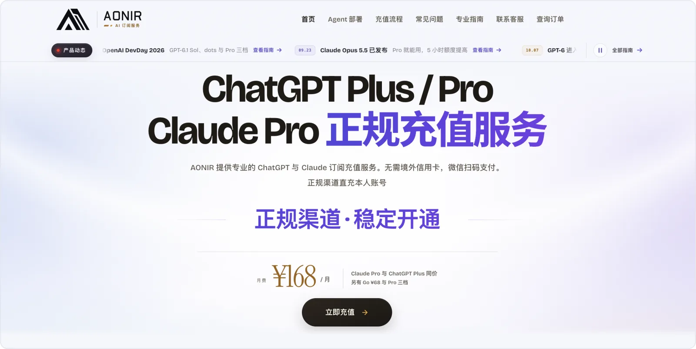
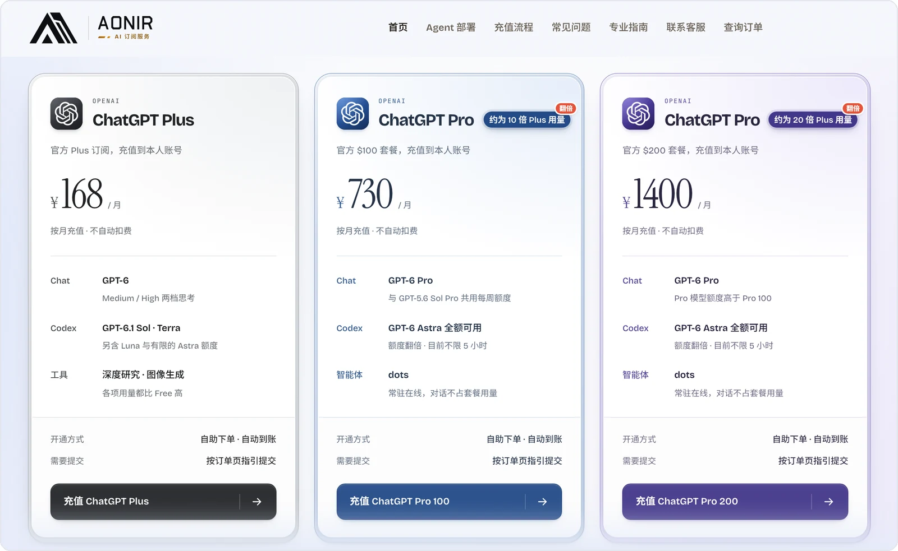
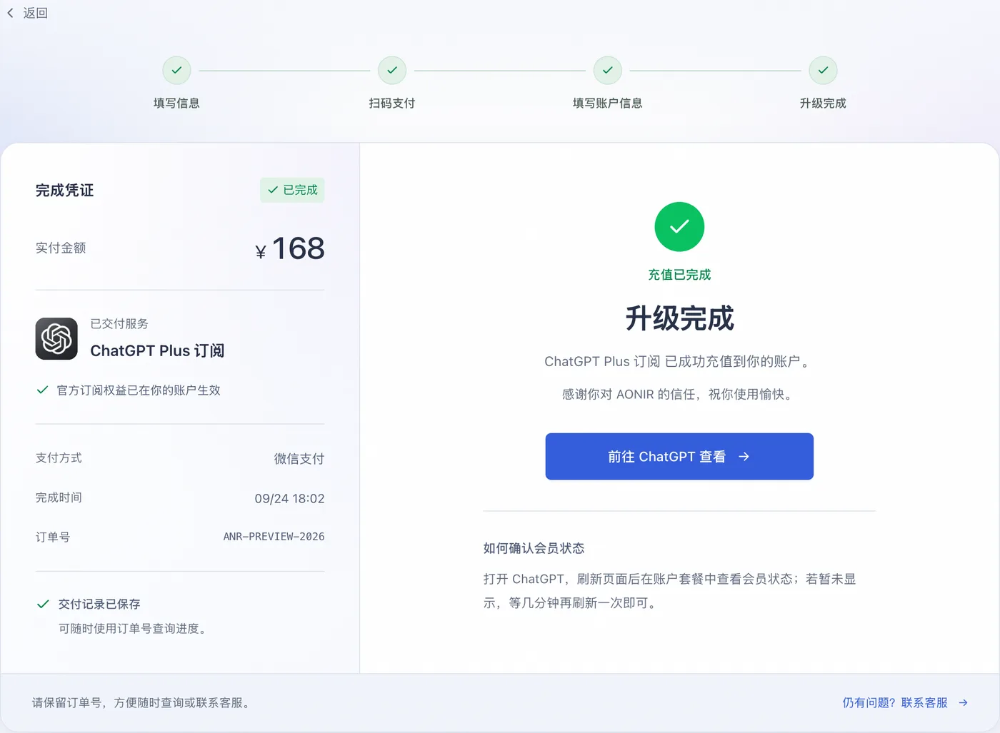
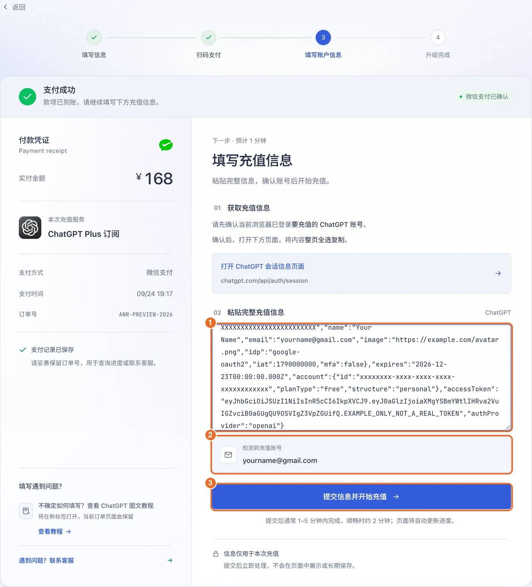
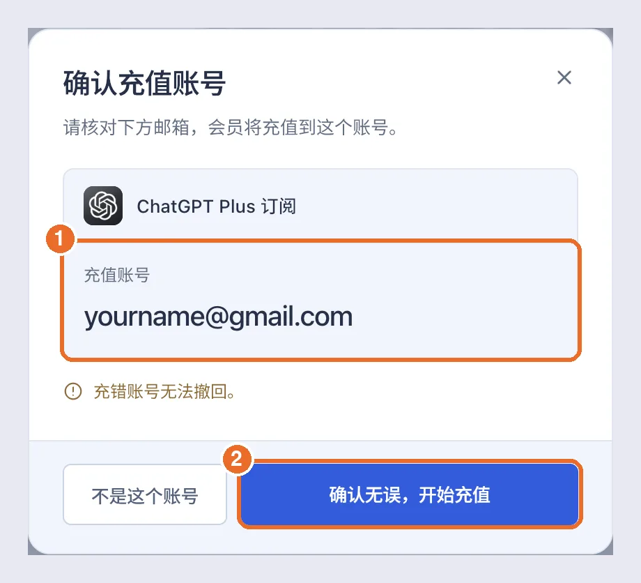
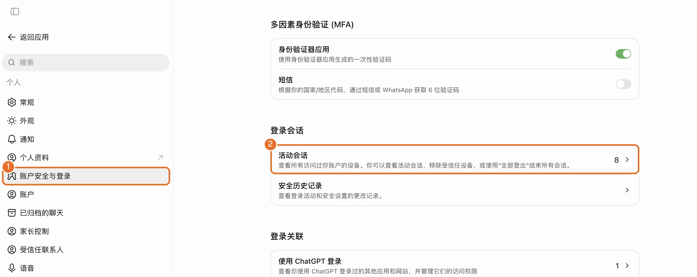
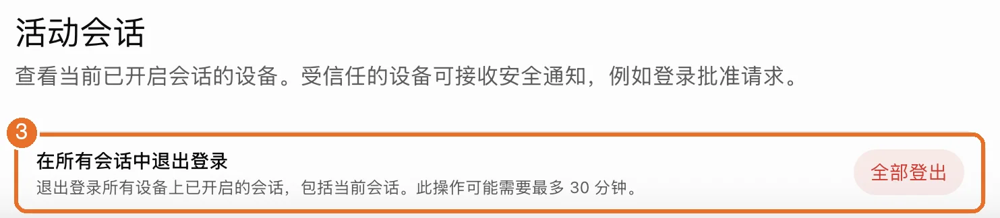
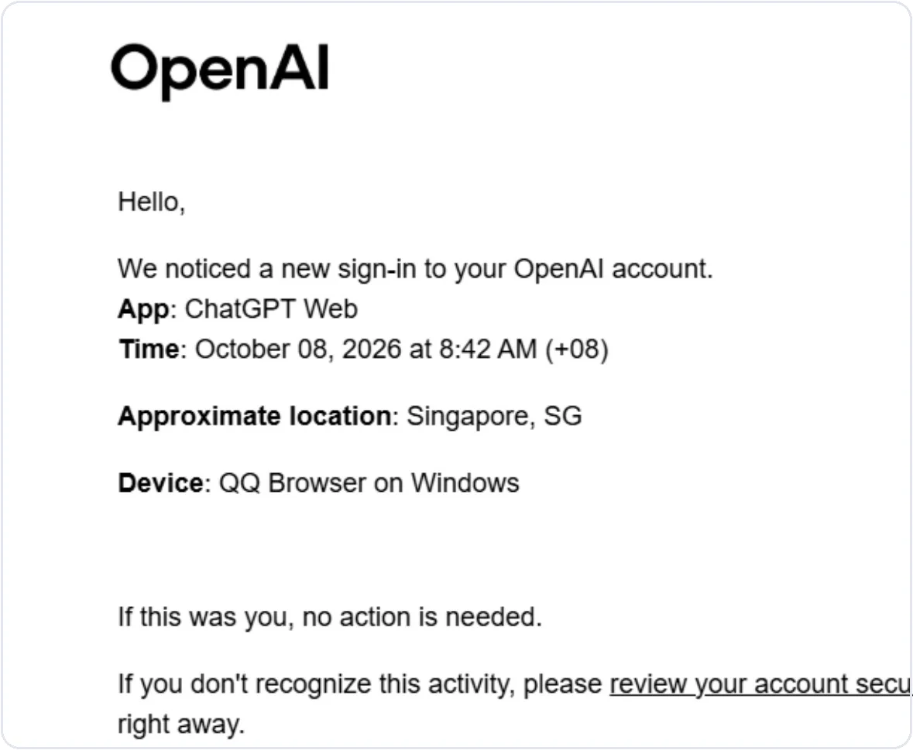
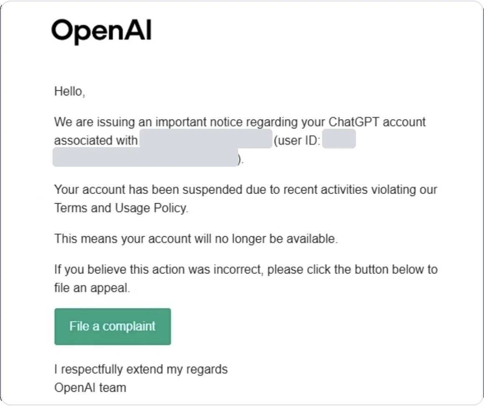
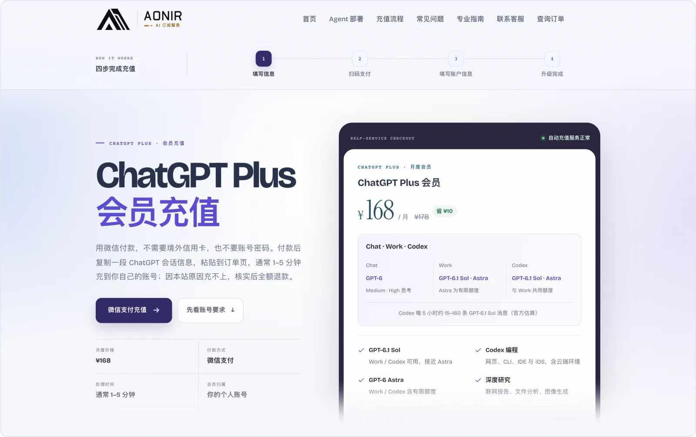

# GPT代充 / ChatGPT代充怎么选（2026）：Plus、Pro 微信支付直充本人账号，附安全说明与避坑清单

> 最后更新：2026 年 10 月 30 日（北京时间）· OpenAI 10 月 29 日把 Pro 的 Work / Codex 额度翻倍，倍数和套餐图随之更新。10 月 24 日首次发布，价格、套餐和条款当天对照 OpenAI 官网核对。
> 信息过期了，欢迎提 Issue。想在价格或套餐变化时收到通知，点右上角 Watch → Custom → Releases。

本指南由 **[AONIR](https://aonir.com/?utm_source=github&utm_medium=referral&utm_campaign=gpt_daichong_guide&utm_content=brand_home)** 维护。AONIR 是独立的第三方会员充值服务：微信支付，充值到你自己的 ChatGPT 账号。

下面先给价格，再把大家搜代充时问得最多的几件事讲清楚：代充是什么原理、交出去的信息安不安全、会不会封号、怎么挑平台。

**[ChatGPT Plus ¥168 / 月 →](https://aonir.com/chatgpt-plus/?utm_source=github&utm_medium=referral&utm_campaign=gpt_daichong_guide&utm_content=top_plus)** · **[Pro 100（约 10 倍 Plus 用量）¥730 / 月 →](https://aonir.com/chatgpt-pro/?utm_source=github&utm_medium=referral&utm_campaign=gpt_daichong_guide&utm_content=top_pro100)** · **[Pro 200（约 20 倍 Plus 用量）¥1400 / 月 →](https://aonir.com/chatgpt-pro-200/?utm_source=github&utm_medium=referral&utm_campaign=gpt_daichong_guide&utm_content=top_pro200)**

通常 1–5 分钟到账 · 微信支付 · 不要账号密码 · 30 天不掉订阅保障 · 订单进度随时可查。另有 [ChatGPT Go](https://aonir.com/chatgpt-go/?utm_source=github&utm_medium=referral&utm_campaign=gpt_daichong_guide&utm_content=top_go)（¥68 / 月），库存以页面为准。

## 目录

- [一、代充是什么，和自己订阅有什么区别](#一代充是什么和自己订阅有什么区别)
- [二、官网为什么付不了款](#二官网为什么付不了款)
- [三、GPT 代充安全吗：你交出去的是什么，我们怎么处理](#三gpt-代充安全吗你交出去的是什么我们怎么处理)
- [四、代充会不会封号](#四代充会不会封号)
- [五、选代充平台的避坑清单](#五选代充平台的避坑清单)
- [六、Plus、Pro 100、Pro 200 怎么选](#六pluspro-100pro-200-怎么选)
- [七、常见问题](#七常见问题)
- [八、延伸阅读](#八延伸阅读)

## 一、代充是什么，和自己订阅有什么区别

代充就是你付人民币，由服务方通过官方订阅渠道，把会员开到**你自己的账号**上。开通后，在 ChatGPT 设置里就能看到套餐和到期时间，和你自己订阅的一样。

市面上叫"代充"的其实有三种，区别很大：

| 形式 | 怎么回事 | 风险 |
|---|---|---|
| **直充本人账号** （AONIR 属于这一种） | 会员开到你自己的账号上， 聊天记录、设置都是你自己的 | 账号始终在你名下 |
| **共享账号** | 几个人合用一个 Plus 号 | 多人轮流登录容易被风控限制， 聊天记录互相能看到 |
| **成品号** | 卖给你一个别人注册好的会员号 | 拿到手要先改密码， 原注册人仍可能把号找回去。 这类号常被批量注册、反复转手， 注册和登录用过的 IP 可能早被滥用； 账号有过异常活动，就容易被官方临时限制， 常见表现是一直提示 「Selected model is at capacity」， 换模型、重试都没用（[两种原因怎么分](https://aonir.com/guides/codex-selected-model-at-capacity/?utm_source=github&utm_medium=referral&utm_campaign=gpt_daichong_guide&utm_content=guide_at_capacity)） |

想自己动手订阅，常见的路是外币卡官网直付、美区 Apple 礼品卡加 iPhone、Google Play。完整步骤和成本见我们的 [ChatGPT Plus 国内充值指南](https://github.com/Avarce/chatgpt-plus-china-guide)。

## 二、官网为什么付不了款

在官网付款时，常见的提示是「付款未获批准」「银行卡被拒绝」。多数是因为国内发行的卡、账单地址和卡片所在地不一致，或者被支付风控拦下了。逐条排查见 [ChatGPT 付款失败与订阅状态排查](https://aonir.com/guides/chatgpt-payment-failed/?utm_source=github&utm_medium=referral&utm_campaign=gpt_daichong_guide&utm_content=guide_payment_failed)。

不想再试卡，可以直接用[微信充值 Plus](https://aonir.com/chatgpt-plus/?utm_source=github&utm_medium=referral&utm_campaign=gpt_daichong_guide&utm_content=payment_failed_plus)。

## 三、GPT 代充安全吗：你交出去的是什么，我们怎么处理

**我们不要你的密码。** 付款后，在电脑浏览器登录要充值的 ChatGPT 账号，打开会话信息页面，整页复制，粘贴到订单页。页面会显示识别到的邮箱，核对无误再提交。

提交前还会再弹一次确认，核对的就是会员要充到的那个邮箱：

**这段会话信息是敏感的。** 它代表你当前这一次登录，拿到它的人可以用你的身份访问账号。所以选代充时，一定要问清楚对方怎么处理它。AONIR 的做法如下，和我们的[隐私政策](https://aonir.com/privacy/?utm_source=github&utm_medium=referral&utm_campaign=gpt_daichong_guide&utm_content=privacy)一致：

- **只用于这一笔订单的充值**，不写进日志，也不作为订单资料保存；
- 只有充值通道临时繁忙、需要自动重试时，才会**加密暂存，最长 1 小时**，任务结束或到期后自动删除；
- 订单里只记下充值到的是哪个账号的邮箱，用来售后核对，**不记录会话信息本身**。

**还是不放心，充完退出所有登录。** 充值完成后，在 chatgpt.com 打开 **设置 → 账户安全与登录**，点「登录会话」下的「**活动会话**」：

拉到页面最下面，在「**在所有会话中退出登录**」这一栏点「**全部登出**」，再重新登录：

按页面上的说明，这会退出所有设备上已开启的会话，包括当前这台，最多可能要 30 分钟才全部生效。会员不受影响，重新登录后照常可用。

另外，任何渠道向你要 ChatGPT 登录密码或邮箱验证码，都不要给。

## 四、代充会不会封号

**先照实说：在我们服务过的上百位 ChatGPT 用户里，仅收到过 2 例封号反馈，查下来都不是充值本身造成的。** 两例的原因都出在使用方式上：

1. **把账号接进账号池**：一位用户把账号接进了账号池、中转工具给别人用，相当于多人轮流登录同一个号。
2. **频繁切换 IP 和登录设备**：另一位一会儿换节点、一会儿换设备，邮箱里不断收到 OpenAI 的陌生登录提醒，账号被判定存在安全风险，最后被停用。

频繁换 IP、换设备时，收到的就是这样的登录提醒：

账号被停用时，收到的是这样一封邮件（邮箱和用户 ID 已打码）：

所以，**充值后自己用、不共享、网络和设备尽量固定**，就避开了我们见过的全部封号原因。账号最终是否被限制由 OpenAI 决定，我们不替 OpenAI 打包票，能做到的是把保障范围写清楚：

> 30 天不掉订阅：会员在 30 天内提前失效、变回免费版的，按剩余天数折算退款。因本站原因充不上的，核实后全额退款。账号封禁、验证失败、网络或设备环境异常、违规使用导致的问题，不在这项保障里。

更多账号安全的做法见 [AI 订阅账号安全指南](https://aonir.com/guides/ai-subscription-account-safety/?utm_source=github&utm_medium=referral&utm_campaign=gpt_daichong_guide&utm_content=guide_safety)。

## 五、选代充平台的避坑清单

拿这张表去对照任何一家，包括我们：

| 看什么 | 靠谱的样子 | 危险信号 |
|---|---|---|
| 充到哪 | 充到你自己的账号 | 给你一个成品号，或拉你进共享号 |
| 要什么信息 | 不要密码 | 要登录密码、邮箱验证码 |
| 敏感信息怎么处理 | 写清楚用在哪、保存多久 | 不说明，或者说"放心" |
| 价格 | 官方价加合理的服务费（Plus 官方 $20 / 月） | 远低于官方价，可能是黑卡、盗刷，过后会掉 |
| 售后 | 写明保障天数和退款规则 | 只说"包稳""永久" |
| 到账和进度 | 写明到账时间，订单状态可查 | 付款后只能干等客服回复 |

AONIR 对照这张表：充到本人账号、不要密码、敏感信息的处理写在[第三节](#三gpt-代充安全吗你交出去的是什么我们怎么处理)、Plus ¥168 / 月、30 天不掉订阅保障、通常 1–5 分钟到账且订单页可查进度。这些在下单页上都写着：

[去下单 →](https://aonir.com/chatgpt-plus/?utm_source=github&utm_medium=referral&utm_campaign=gpt_daichong_guide&utm_content=checklist_plus)

## 六、Plus、Pro 100、Pro 200 怎么选

OpenAI 官方价格（2026 年 10 月 24 日核对）：Plus $20 / 月，Pro 100 $100 / 月，Pro 200 $200 / 月，Pro 500 $500 / 月。官方页面只说 Pro 200 比 Pro 100 用量多、Pro 500 最多；下面的倍数是 Codex 负责人 Tibo 在 X 上的说法，都是约数。

**美国时间 10 月 29 日起，Pro 的 Work / Codex 额度翻倍**：Pro 100、Pro 500 直接翻倍；Pro 200 原定下调老订阅额度的计划取消，较低的那档翻倍，所有 Pro 200 订阅额度相同。翻倍后三档约为 Plus 的 10、20、50 倍（50 倍是 Tibo [亲自确认](https://x.com/thsottiaux/status/2115851811576053881)的）。Chat 里 GPT-6 Pro 的每周额度，Pro 100 和 Pro 500 不变；Plus 不变。已经是 Pro 的账号自动生效。依据：[OpenAI 帮助中心](https://help.openai.com/en/articles/9793128-about-chatgpt-pro-tiers)、[Tibo 原帖](https://x.com/thsottiaux/status/2115850175868727621)，详见 [Pro 额度翻倍说明](https://aonir.com/guides/chatgpt-pro-usage-doubled/?utm_source=github&utm_medium=referral&utm_campaign=gpt_daichong_guide&utm_content=guide_pro_doubled)。

很多人搜的「gpt pro 5x」「gpt pro 20x」，现在官方叫 **Pro 100** 和 **Pro 200**。10 月 29 日翻倍之后，Pro 100 约为 Plus 的 10 倍，Pro 200 约为 20 倍，又和原来「20x」的叫法对上了。

- **先选 Plus**：日常写作、学习、编程基本够用。[Plus ¥168 →](https://aonir.com/chatgpt-plus/?utm_source=github&utm_medium=referral&utm_campaign=gpt_daichong_guide&utm_content=choose_plus)
- **Work / Codex 经常因为用量耗尽中断**，换 Pro 100，Work / Codex 用量约为 Plus 的 10 倍。[Pro 100 ¥730 →](https://aonir.com/chatgpt-pro/?utm_source=github&utm_medium=referral&utm_campaign=gpt_daichong_guide&utm_content=choose_pro100)
- **Pro 100 也常用完**，换 Pro 200，约为 Plus 的 20 倍。[Pro 200 ¥1400 →](https://aonir.com/chatgpt-pro-200/?utm_source=github&utm_medium=referral&utm_campaign=gpt_daichong_guide&utm_content=choose_pro200)
- **Pro 500**（约为 Plus 的 50 倍，另有 Ultrafast）由客服开通，见 [Pro 500 页面](https://aonir.com/chatgpt-pro-500/?utm_source=github&utm_medium=referral&utm_campaign=gpt_daichong_guide&utm_content=choose_pro500)。

各档能用哪些模型、额度怎么算，见 [ChatGPT Free、Plus 与 Pro 怎么选](https://aonir.com/guides/chatgpt-free-plus-pro/?utm_source=github&utm_medium=referral&utm_campaign=gpt_daichong_guide&utm_content=guide_plans)。

## 七、常见问题

**代充之后还能自己续费吗？**
可以。会员到期后，用什么方式续都行。在 AONIR 续费，新的一个月会直接覆盖当前会员，剩下的天数不会叠加，所以建议临近到期再操作。

**已有 Plus，想升级 Pro 怎么办？**
可以直接覆盖升级。升级后从当天起算 30 天 Pro，Plus 剩下的天数不会叠加上去。比如 Plus 还剩 10 天时升级，这 10 天就没了。

所以不急的话，建议等 Plus 快到期再升级。着急用 Pro，也可以拿一个新账号直接开 Pro，原账号的 Plus 照常用到到期，两边互不影响；只是聊天记录不会带到新账号上。

**多久到账？**
提交信息后通常 1–5 分钟，顺利的话 2 分钟左右。高峰时段会慢一些，进度以订单页显示为准。

**能开发票吗？**
暂时还开不了发票。

**只用手机 App，可以充吗？**
可以，会员在 App 里一样生效。只是会话信息只能在电脑浏览器里复制，先用电脑浏览器登录一次 chatgpt.com，再按订单页的步骤操作。

**账号同时在 Business 工作区里，能充个人 Plus 吗？**
可以，先在 chatgpt.com 左下角头像里切换回个人账号（Personal），再复制会话信息。在工作区状态下复制的信息，提交后可能会报错。

**充不上怎么办？**
因本站原因充不上的，核实后全额退款。订单页可以直接联系客服。

**用什么付款？**
微信支付。

**能单独充 Codex 额度（credits）吗？**
不能。我们充的是 Plus、Pro 这些套餐，不卖单独的 Codex credits。套餐本身就带 Codex 用量，Pro 的用量比 Plus 多。

## 八、延伸阅读

- [ChatGPT Plus 国内充值指南：美区 Apple 礼品卡实测](https://github.com/Avarce/chatgpt-plus-china-guide)（想自己订阅的看这篇）
- [Codex 国内使用指南](https://github.com/Avarce/codex-china-guide)
- [ChatGPT 付款失败与订阅状态排查](https://aonir.com/guides/chatgpt-payment-failed/?utm_source=github&utm_medium=referral&utm_campaign=gpt_daichong_guide&utm_content=more_payment_failed)
- [ChatGPT Pro 国内充值](https://aonir.com/guides/chatgpt-pro-china-recharge/?utm_source=github&utm_medium=referral&utm_campaign=gpt_daichong_guide&utm_content=more_pro)
- [AI 订阅账号安全指南](https://aonir.com/guides/ai-subscription-account-safety/?utm_source=github&utm_medium=referral&utm_campaign=gpt_daichong_guide&utm_content=more_safety)

---

本指南由 AONIR 维护，价格以下单页为准。官方信息来源：[ChatGPT 定价](https://chatgpt.com/pricing/)、[About ChatGPT Pro tiers](https://help.openai.com/en/articles/9793128-about-chatgpt-pro-tiers)。
